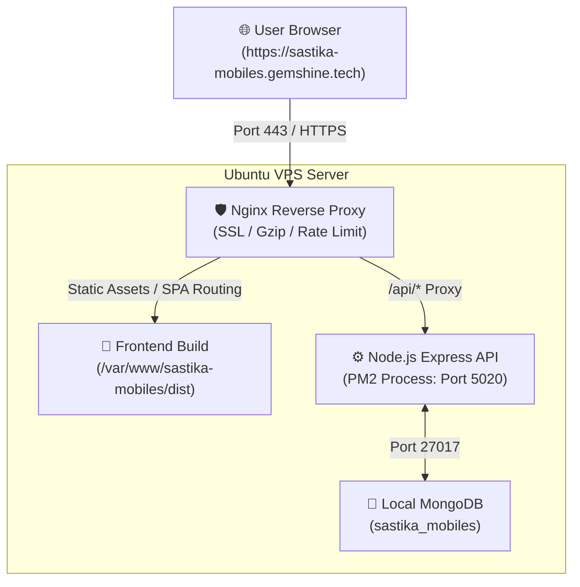

# 🚀 Sastika Mobiles - VPS Deployment & Production Setup Guide

Complete step-by-step guide to deploying **Sastika Mobiles** (Frontend + Backend + MongoDB + Nginx + PM2) on an Ubuntu VPS with domain **`sastika-mobiles.gemshine.tech`** and backend port **`5020`**.

---

## 📌 Architecture Overview



---

## 📋 Pre-Deployment Checklist

1. **VPS IP Address** (e.g. `123.45.67.89`)
2. **DNS Record**: Point `sastika-mobiles.gemshine.tech` to your VPS IP:
   - **Type**: `A`
   - **Host / Name**: `sastika-mobiles`
   - **Value**: Your VPS IP
   - **TTL**: Auto or 300s
3. **SSH Access**: `ssh root@your-vps-ip`

---

## 🛠️ Step 1: VPS Environment Initialization

Connect to your VPS via SSH and run the automated setup script, or run each command manually:

### Option A: Run Automated VPS Setup Script
```bash
# Clone the repository
sudo mkdir -p /var/www/sastika-mobiles
sudo chown -R $USER:$USER /var/www/sastika-mobiles
git clone https://github.com/gemshineinfotechdevelopment/sastika-mobile-website.git /var/www/sastika-mobiles
cd /var/www/sastika-mobiles

# Make scripts executable
chmod +x scripts/*.sh deploy.sh

# Run core VPS environment setup (Node.js 20, PM2, Nginx, Certbot, Firewall)
./scripts/setup-vps.sh
```

### Option B: Manual Setup Commands
```bash
# Update Ubuntu packages
sudo apt update && sudo apt upgrade -y
sudo apt install -y curl wget git ufw htop build-essential

# Install Node.js 20 LTS
curl -fsSL https://deb.nodesource.com/setup_20.x | sudo -E bash -
sudo apt install -y nodejs

# Install PM2 Process Manager
sudo npm install -g pm2

# Install Nginx & Certbot
sudo apt install -y nginx certbot python3-certbot-nginx

# Configure UFW Firewall
sudo ufw allow OpenSSH
sudo ufw allow 'Nginx Full'
sudo ufw allow 5020/tcp
sudo ufw --force enable
```

---

## 🍃 Step 2: Install & Configure MongoDB on VPS

Run the included MongoDB installer:

```bash
cd /var/www/sastika-mobiles
./scripts/setup-mongodb.sh
```

Or execute manually:
```bash
# Import MongoDB 7.0 GPG Key & Repo
curl -fsSL https://www.mongodb.org/static/pgp/server-7.0.asc | sudo gpg -o /usr/share/keyrings/mongodb-server-7.0.gpg --dearmor --yes
echo "deb [ arch=amd64,arm64 signed-by=/usr/share/keyrings/mongodb-server-7.0.gpg ] https://repo.mongodb.org/apt/ubuntu jammy/mongodb-org/7.0 multiverse" | sudo tee /etc/apt/sources.list.d/mongodb-org-7.0.list

# Install MongoDB
sudo apt update
sudo apt install -y mongodb-org

# Start and enable MongoDB systemd service
sudo systemctl enable mongod
sudo systemctl start mongod

# Verify status (should say "active (running)")
sudo systemctl status mongod
```

---

## 📦 Step 3: Configure Environment Variables

Create and verify production configuration files:

### 1. Root Frontend Environment (`/var/www/sastika-mobiles/.env.production`)
```env
VITE_API_URL=/api
VITE_APP_NAME="Sastika Mobiles"
VITE_ENABLE_MOCK_FALLBACK=true
```

### 2. Backend Server Environment (`/var/www/sastika-mobiles/server/.env`)
```bash
cp /var/www/sastika-mobiles/server/.env.production /var/www/sastika-mobiles/server/.env
```
Ensure contents match:
```env
PORT=5020
NODE_ENV=production
MONGO_URI=mongodb://127.0.0.1:27017/sastika_mobiles
DB_NAME=sastika_mobiles
CLIENT_URL=https://sastika-mobiles.gemshine.tech
JWT_SECRET=sastika_production_super_secure_jwt_secret_key_2026
JWT_EXPIRES_IN=30d
```

---

## 🌱 Step 4: Seed Database with Sastika Mobiles Catalog

Run the dedicated database seeder to populate all products, orders, tickets, and flash deals:

```bash
cd /var/www/sastika-mobiles/server
npm install
npm run seed
```

You should see:
```text
========================================================
🌱 Starting Sastika Mobiles Database Seed on VPS...
🔗 Connecting to: mongodb://127.0.0.1:27017/sastika_mobiles
✅ MongoDB connected successfully!
📦 Seeding Products...
   ✓ Inserted 18 retail products.
📋 Seeding Orders...
   ✓ Inserted demo orders.
🔧 Seeding Service Tickets...
   ✓ Inserted repair tickets.
⚡ Seeding Flash Deals...
   ✓ Flash Deal created with active festival countdown.
👤 Seeding Admin User...
   ✓ Admin user ready: admin@sastikamobiles.com (password: admin123)
========================================================
🎉 DATABASE SEEDING COMPLETED SUCCESSFULLY!
```

---

## ⚙️ Step 5: Start Backend with PM2

Start the Node.js backend on port `5020` using the ecosystem configuration:

```bash
cd /var/www/sastika-mobiles

# Start backend using PM2 production profile
pm2 start ecosystem.config.cjs --env production

# Save PM2 process list to restore automatically on VPS reboot
pm2 save
pm2 startup systemd -u $USER --hp $HOME
```

### Useful PM2 Commands:
```bash
pm2 status                       # Check status of sastika-backend
pm2 logs sastika-backend         # View real-time output & error logs
pm2 reload sastika-backend       # Zero-downtime reload
pm2 restart sastika-backend      # Full restart
```

---

## 🛡️ Step 6: Configure Nginx & SSL

### 1. Copy Initial HTTP Configuration
```bash
sudo cp /var/www/sastika-mobiles/nginx/initial-http.conf /etc/nginx/sites-available/sastika-mobiles.gemshine.tech
sudo ln -sf /etc/nginx/sites-available/sastika-mobiles.gemshine.tech /etc/nginx/sites-enabled/

# Remove default site if present
sudo rm -f /etc/nginx/sites-enabled/default

# Test Nginx and reload
sudo nginx -t
sudo systemctl reload nginx
```

### 2. Generate Free SSL Certificate with Let's Encrypt Certbot
```bash
sudo certbot --nginx -d sastika-mobiles.gemshine.tech
```
- Enter your email address when prompted.
- Select `Redirect all HTTP traffic to HTTPS` (Option 2).
- Certbot will automatically install the certificate and update your Nginx configuration!

### 3. (Optional) Apply Optimized High-Performance SSL Configuration
Once Certbot has generated your certificates, you can apply our fully optimized Nginx template:
```bash
sudo cp /var/www/sastika-mobiles/nginx/sastika-mobiles.gemshine.tech.conf /etc/nginx/sites-available/sastika-mobiles.gemshine.tech
sudo nginx -t
sudo systemctl reload nginx
```

---

## 🔨 Step 7: Build Frontend

Build the Vite production bundle into `/var/www/sastika-mobiles/dist`:
```bash
cd /var/www/sastika-mobiles
npm install
npm run build
```

---

## 🚀 One-Command Automated Redeployment (`./deploy.sh`)

Whenever you make updates on GitHub, simply run this one command on your VPS:

```bash
cd /var/www/sastika-mobiles
./deploy.sh
```

Or with database re-seed:
```bash
./deploy.sh --seed
```

The script will automatically:
1. `git pull origin main`
2. Install dependencies & build frontend bundle (`npm run build`)
3. Install backend dependencies (`server/`)
4. Zero-downtime reload backend via PM2 (`pm2 reload ecosystem.config.cjs --env production`)
5. Test backend health on `http://127.0.0.1:5020/api/health`
6. Test and reload Nginx (`sudo nginx -t && sudo systemctl reload nginx`)

---

## 🩺 Step 8: Verification & Health Checks

| Check | URL / Command | Expected Result |
| :--- | :--- | :--- |
| **Storefront** | `https://sastika-mobiles.gemshine.tech` | Loads modern Sastika Mobiles homepage |
| **Admin Portal** | `https://sastika-mobiles.gemshine.tech/#/admin` | Loads enterprise retail admin panel |
| **Backend API Health** | `https://sastika-mobiles.gemshine.tech/api/health` | `{"status":"OK","database":"Connected (MongoDB)"}` |
| **Local Port Check** | `curl http://127.0.0.1:5020/api/health` | Returns JSON status from Express |
| **MongoDB Service** | `sudo systemctl status mongod` | Active (running) |
| **PM2 Process** | `pm2 status` | `sastika-backend` is online, 0 errors |

---

## ❓ Troubleshooting

### 1. `Port 5020 already in use`
Find and terminate process on port 5020:
```bash
sudo lsof -i :5020
sudo kill -9 <PID>
pm2 reload sastika-backend
```

### 2. Backend says `Database: In-Memory / Fallback Mode`
Check if MongoDB is running:
```bash
sudo systemctl restart mongod
sudo systemctl status mongod
# Check server log
pm2 logs sastika-backend --lines 50
```

### 3. Nginx 502 Bad Gateway
The backend process is not running or crashed:
```bash
pm2 status
pm2 logs sastika-backend
# Restart it
pm2 restart sastika-backend
```
